<!--
  Profile artwork lives in /assets and is generated by scripts/build.py (edit content there, re-run).
  assets/activity.svg is regenerated daily by .github/workflows/activity.yml.
-->

  

  

 

<picture>
  <source media="(prefers-color-scheme: dark)" srcset="assets/h-work-dark.svg">
  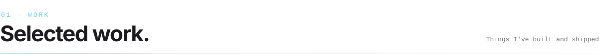
</picture>

  <a href="https://github.com/ravideo9021/ai-digital-twin-lifestyle"></a>
  <a href="https://github.com/ravideo9021/signspeak"></a>

  <a href="https://github.com/ravideo9021/uav-residual-control"></a>
  <a href="https://github.com/ravideo9021/Multilingual-RAG-System"></a>

  <a href="https://github.com/ravideo9021/Autonomous-Data-Analyst-LLM-Powered-Agentic-System"></a>
  <a href="https://github.com/ravideo9021/sales-forecasting-inventory-ml"></a>

 

<picture>
  <source media="(prefers-color-scheme: dark)" srcset="assets/h-toolkit-dark.svg">
  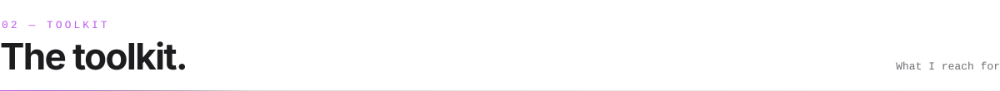
</picture>

  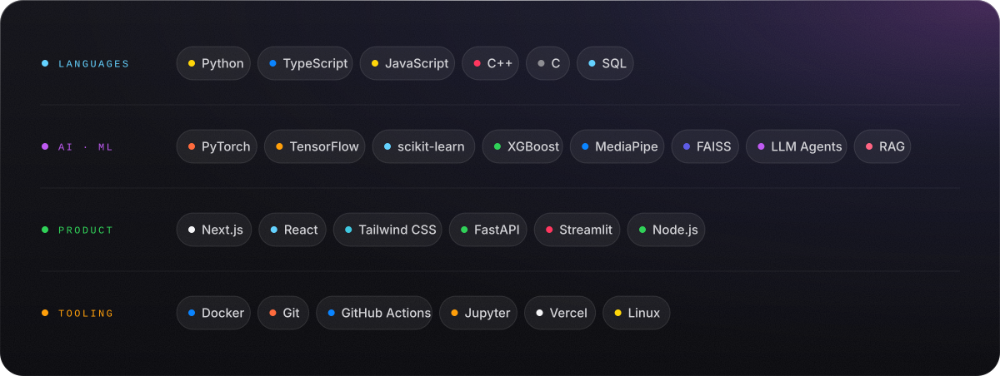

 

<picture>
  <source media="(prefers-color-scheme: dark)" srcset="assets/h-activity-dark.svg">
  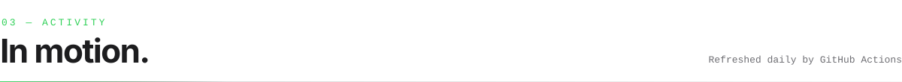
</picture>

  

 

  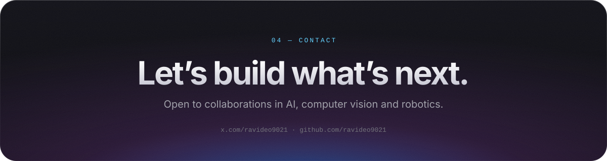

  <a href="https://x.com/ravideo9021">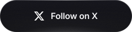</a>
  &nbsp;
  

